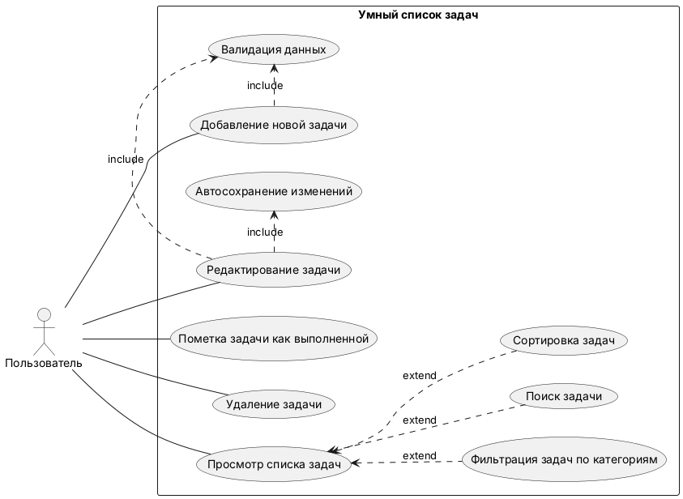
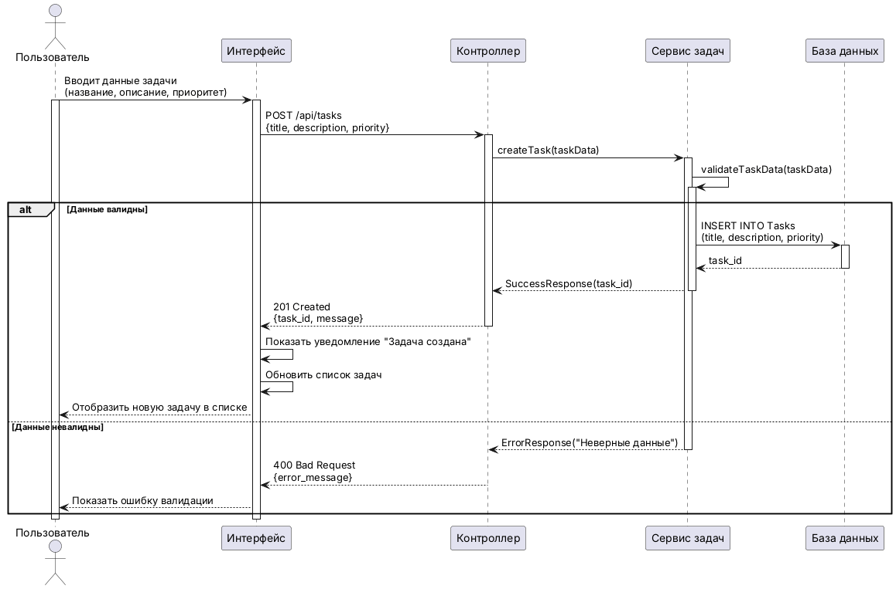
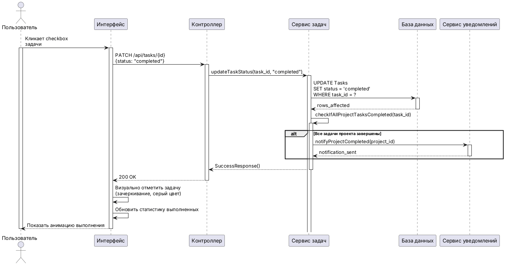
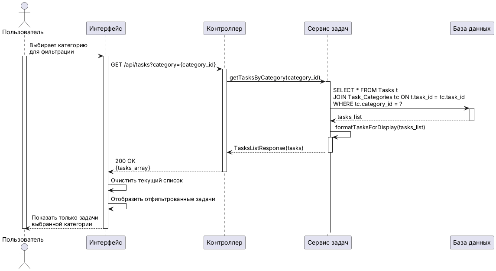
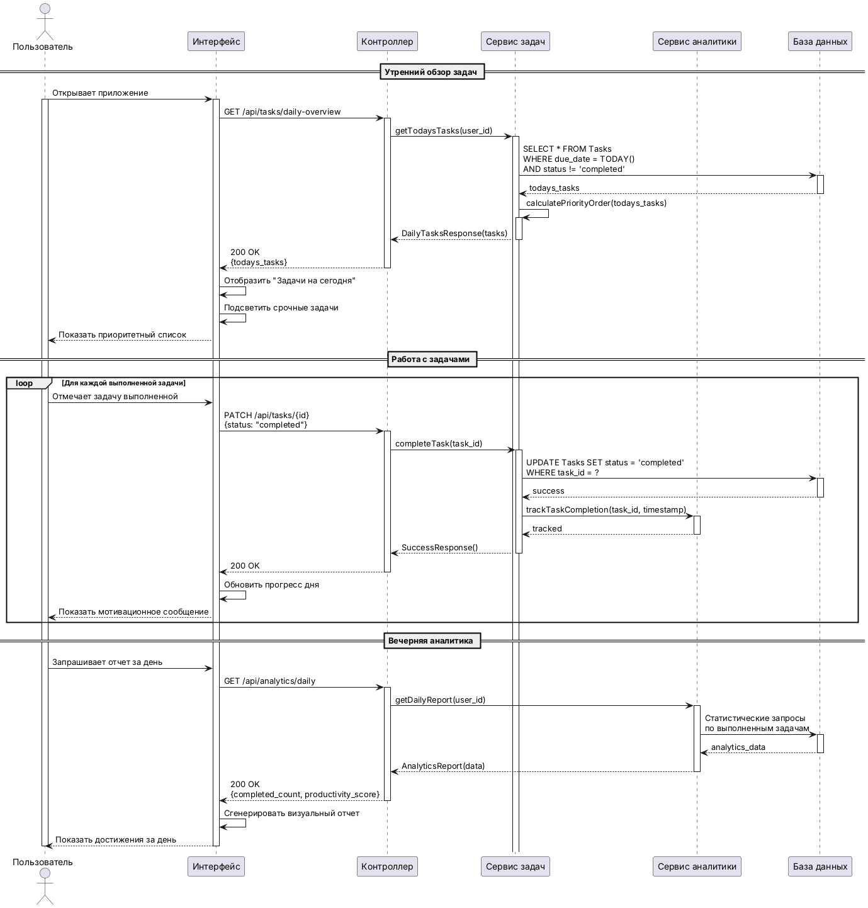

# Диаграммы поведения системы

## Use Case Диаграмма

Описание основных сценариев использования приложения "Умный список задач"

### Акторы:

- **Пользователь** - основной пользователь системы

### Основные Use Cases:

- Добавление задач
- Просмотр и фильтрация
- Управление статусами
- Работа с проектами и категориями

## Диаграммы последовательности

### 1. Добавление задачи

Показывает процесс создания новой задачи с валидацией

### 2. Отметка выполнения

Демонстрирует процесс завершения задачи и связанные действия

### 3. Фильтрация задач

Отображает механизм фильтрации по категориям

### 4. Ежедневный workflow

Комплексный сценарий типичного рабочего дня пользователя

## Используемые инструменты

- **PlantUML** - для кодового представления диаграмм
- **draw.io** - для визуального редактирования
